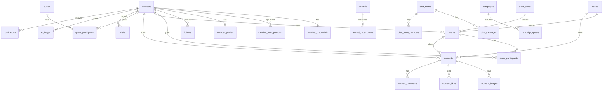

# Database Design — Chill & Connect Hub

Status: **approved by owner** (2026-10-25, decisions in §9). Nothing is migrated yet.
Target: Supabase Postgres 17 (Singapore), used as plain Postgres + Realtime. Our own member/staff auth stays; images stay in Vercel Blob.

Goals, in order: **security**, **performance**, **scalability** — while staying simple enough for a prototype team.

---

## 1. What we store today (inventory)

| Area | Today (JSON file) | Rows now | Problem when it grows |
| :--- | :--- | ---: | :--- |
| Members, sessions, profile, consent, follows, blocks, saved items, reports received | `members.json` (everything inside one record) | 40 | Every read loads every member; follows/saves as arrays inside a member |
| Staff accounts | via `staffStore` | few | — |
| ตี้ + อีเวนต์ | `chill_database.json → events` | 257 | Dates stored as text (`date` + `time`), filters done in JS |
| Participants, tickets, check-in | `chill_database.json → participants` (map by event) | 66 events | Join safety relies on a file lock |
| Cancelled joins, waitlist | `members.cancelledEvents`, `waitlist.json` | — | Three places for one fact |
| Places (spots) | `discovery_content.json → spots` | 2,179 | 8.6 MB file read for one page |
| Challenges | `discovery_content.json → quests` | 35 | — |
| Challenge joins / finishes / reward codes | `quest_joins`, `quest_finishes`, `quest_vouchers` | small | — |
| Visits (marked + reviews) | `visits.json` | small | XP recomputed by scanning everything |
| Moments, likes, saves, comments, reports | `moments.json` (arrays inside each moment) | 24 | Likes as arrays; "popular" sort counts arrays |
| Stories, views | `stories.json` | 0 | — |
| Chat | `chat_messages.json` (room id = event id / `grp_…` / `pair~a~b`) | 106 | Clients poll every 4 s |
| Notifications | `notifications.json` | small | Polling |
| Event Q&A, reviews, meet-again picks, fair groups | separate files | small | — |
| Rewards shop | `data/rewardsData.ts` (code) | — | Stock cannot change at runtime |
| Redemptions | `redemptions.json` | 0 | No guard against double spend across servers |
| Campaigns | `campaigns.json` | 1 | Stats scan all members |
| Content reports | `content_reports.json` | 0 | — |
| Master data (categories, vibes, provinces, zones, venues, clubs) | `master_data.json` | ~170 | — |
| Scraper sources | `chill_database.json → sources` | 13 | — |
| Audit log | `audit_log.json` | 724 | Grows forever in one file |
| Rate limits | in server memory | — | **Does not work on Vercel** (each server has its own memory) |
| Legacy mock: `tickets`, `hostWallet`, old `reviews` | `chill_database.json` | — | Not used by current features |

---

## 2. Design principles (the rules every table follows)

1. **Normalised to 3NF.** One fact in one place. Lists inside records (likes, follows, saves, member ids) become join tables.
2. **Real foreign keys, never "type + id" for core links.** Where something can point at a place, a ตี้/อีเวนต์ or a challenge, use separate nullable columns (`place_id`, `event_id`, `quest_id`) plus a `CHECK` that the right one is set. Only reports and the audit log keep `target_type + target_id`, because they point at anything and must survive deletion.
3. **Times are `timestamptz` (UTC).** Bangkok time only on screen. `starts_at` / `ends_at` replace text `date` + `time`.
4. **Keys:** `uuid` primary keys, generated as **UUIDv7** in the app (time-ordered, so indexes stay compact and new rows land at the end). Public URLs use a `slug` column; during the move every current id becomes the slug, so **no URL changes and no SEO loss**.
5. **The database enforces the rules, not only the form.** Lengths, ranges, enums and uniqueness are `CHECK`/`UNIQUE` constraints (title ≥ 5, description ≥ 15, ตี้ size 2–15, rating 1–5, caption ≤ 500…).
6. **Hot counts are stored, not counted.** `participants_count`, `like_count`, `comment_count` are updated in the same transaction as the row they count.
7. **Money-like values use a ledger.** XP is an append-only ledger; the balance is a cached sum. No balance is ever "set".
8. **Every foreign key has an index** (Postgres does not add them automatically).
9. **Sample data is marked** (`is_sample`) so it can be removed in one statement before launch.

---

## 3. Schema overview



Tables live in a schema called **`app`** (not `public`) — see §5.

---

## 4. Tables

Notation: `PK` primary key, `FK` foreign key, `UQ` unique, `?` nullable. Every table also has `created_at timestamptz not null default now()`; mutable tables have `updated_at`.

### 4.1 Identity & access

**members** — one row per account. Only what is needed everywhere.
`id PK` · `display_name` (1–40) · `email citext? UQ` · `email_verified_at?` · `avatar_url?` · `status` enum(active, suspended, banned) · `suspended_until?` · `status_reason?` · `session_version int` · `invite_code UQ` · `invited_by FK members?` · `signup_ip_hash?` · `onboarded_at?` · `last_login_at?` · `last_login_method?` · `is_sample bool`

**member_credentials** — kept apart so a careless `select *` on members never returns a hash.
`member_id PK FK` · `password_hash` · `password_changed_at`

**member_auth_providers** — Google / Facebook / Apple.
`PK (provider, subject)` · `member_id FK` · `linked_at`

**member_tokens** — email verification and password reset (hashes only).
`id PK` · `member_id FK` · `purpose` enum(verify_email, reset_password) · `token_hash UQ` · `expires_at` · `used_at?`

**member_profiles** — the detailed, hideable profile.
`member_id PK FK` · `bio?` `occupation?` `workplace?` `education?` `hometown?` `living_area?` `relationship_status?` `connect_goal?` · `birth_year?` · `gender?` · `province_code FK?` · `intent` enum(member, host, venue, organizer) · `goals text[]` · `hidden_fields text[]`

**member_interests** — `PK (member_id, category_id)`

**member_consents** — append-only history (terms, safety pledge, age).
`id PK` · `member_id FK` · `kind` enum(terms, pledge, age) · `version` · `source` · `accepted_at`

**host_applications** — `id PK` · `member_id FK` · `kind` · `about` · `link?` · `status` enum(pending, approved, rejected) · `reviewed_by FK staff?` · `reviewed_at?` · `note?`

**member_risk_flags** — `id PK` · `member_id FK` · `code` enum · `detail` · `reviewed_at?`

**staff_accounts** — `id PK` · `email citext UQ` · `name` · `role` enum(owner, editor, moderator, data_ops) · `status` · `password_hash` · `session_version` · `created_by FK?` · `last_login_at?`

### 4.2 Social graph

| Table | Columns | Notes |
| :--- | :--- | :--- |
| **follows** | `PK (follower_id, followee_id)` | index on `followee_id` for "followers" |
| **blocks** | `PK (blocker_id, blocked_id)` | checked on every social read |
| **saved_items** | `member_id`, `place_id?`, `event_id?`, exactly one set | replaces `savedSpotIds` / `savedEventIds` |
| **meet_again_picks** | `PK (event_id, from_id, to_id)` | mutual pick opens a direct chat |

### 4.3 Reference data (was `master_data.json`)

- **provinces** `code PK` · `name_th` · `name_en` · `region` · **zones**
- **categories** — one table for all pillars: `id PK` · `pillar` enum(community, fair, place, quest, moment, vibe, mood) · `slug` · `label_th` · `group_key?` · `sort` · `active`. `UQ (pillar, slug)`.
- **venues**, **venue_groups**, **community_clubs** — small lookup tables as today.

### 4.4 Places

**places** — `id PK` · `slug UQ` · `title` · `category_id FK` · `province_code FK` · `district?` · `description` · `location geography(Point)?` (PostGIS) · `open_hours jsonb` · `price?` · `entry_fee?` · `best_time?` · `transit_info?` · `contact jsonb` · `facilities text[]` · `highlights text[]` · `google_maps_url?` · `rating numeric(2,1)?` · `reviews_count` · `popularity` · `meetup_allowed bool` · `publication_status` enum(draft, published) · `source_id FK?` · `source_url?` · `curation_score` · `curation_tier` · `curation_override?` · `curation_note?` · `curation_by FK staff?` · `curation_at?` · `search_text` (generated)

- **place_images** `PK (place_id, position)` · `url`
- **place_vibes** `PK (place_id, category_id)`

### 4.5 ตี้ and อีเวนต์ (one table, two pillars)

**event_series** — recurring ตี้. `id PK` · `host_member_id FK` · `recurrence jsonb` (rule)

**events** — one row per occurrence.
`id PK` · `slug UQ` · `event_type` enum(community, public_venue) · `title` (≥5) · `description` (≥15) · `category_id FK` · `province_code FK` · `zone?` · `location_name` · `meeting_point?` · `location geography?` · `place_id FK?` · `series_id FK?` · `starts_at` · `ends_at` (`CHECK ends_at >= starts_at`) · `location_type` enum(physical, online) · `online_platform?` · `online_join_url?` · `host_member_id FK?` (null for imported อีเวนต์) · `organizer_name?` · `min_participants?` · `max_participants?` · `participants_count int default 0` (`CHECK ≤ max`) · `price_text?` · `audience_tags text[]` (solo, beginner, pet, introvert, english, kids, bring_friend) · `target_gender?` · `cancellation_policy?` · `approval_status` enum(pending, approved, rejected) · `rejection_reason?` · `moderated_at?` · `moderated_by FK staff?` · `cover_image_url` · `source_id FK?` · `source_url?` · `external_url?` · `details jsonb` (itinerary, rules, what to bring, instructions, sub-activities, race distances — shown, never filtered) · `is_sample`

Rules as constraints: community ตี้ must have `host_member_id`, `max_participants BETWEEN 2 AND 15`; อีเวนต์ must have `organizer_name` and no participant cap.
`status` (upcoming / ongoing / ended) is **computed from `starts_at`/`ends_at`**, not stored, so it can never go stale.

**event_participants** — joins, cancellations, waitlist and check-in in one place.
`PK (event_id, member_id)` · `status` enum(joined, cancelled, waitlisted, offered) · `ticket_code` (`UQ (event_id, ticket_code)`) · `joined_at` · `offered_at?` · `cancelled_at?` · `checked_in_at?` · `note?`

**Safe join (no overbooking, even with many servers):**
```sql
-- one transaction
UPDATE app.events SET participants_count = participants_count + 1
 WHERE id = $1 AND participants_count < max_participants AND ends_at > now()
RETURNING id;            -- 0 rows → full or ended
INSERT INTO app.event_participants (...) VALUES (...)
ON CONFLICT (event_id, member_id) DO UPDATE SET status = 'joined' ...;
```

Also: **event_questions** (`id`, `event_id`, `author_id`, `text`, `answer_text?`, `answered_at?`, `hidden`) · **event_reviews** (`UQ (event_id, author_id)`, `rating 1–5`, `text`) · **fair_groups** + **fair_group_members** `PK (group_id, member_id)`.

### 4.6 Challenges, visits, XP, rewards

**quests** — `id PK` · `slug UQ` · `title` · `category_id FK` · `objective` · `steps jsonb` · `starts_at?` · `ends_at?` · `status` enum(draft, active, ended) · `visibility` · `is_official` · `created_by_member_id FK?` · `reward_points` · `rule jsonb` (the rule engine input; validated by the app) · `brand_reward jsonb?` · `badge_label` · `badge_icon?` · `cover_image_url?`

**quest_participants** — replaces joins + finishes. `PK (quest_id, member_id)` · `joined_at` · `finished_at?`

**quest_vouchers** — `code PK` · `quest_id FK` · `member_id FK` · `issued_at` · `used_at?` · `UQ (quest_id, member_id)`

**visits** — every "I was there", with its strength of evidence.
`id PK` · `member_id FK` · `place_id? / event_id?` (exactly one) · `evidence` enum(marked, moment, checkin) · `moment_id FK?` · `pending bool` · `rating 1–5?` · `review?` · `reviewed_at?`
`UQ (member_id, place_id, evidence)` and `UQ (member_id, event_id, evidence)`.

**xp_ledger** — append-only.
`id bigint identity PK` · `member_id FK` · `delta int` · `reason` enum(visit, quest_reward, campaign, redemption, adjustment) · `ref_id uuid?` · `UQ (member_id, reason, ref_id)` → the same visit can never pay twice.

**member_stats** — cached read model: `member_id PK` · `xp_balance` · `xp_earned` · `events_joined` · `moments_count` — updated in the same transaction as the ledger.

**rewards** (moves out of code so staff can edit stock) — `id PK` · `title` · `category` · `partner` · `partner_location` · `cost_xp` · `stock_count` (`CHECK ≥ 0`) · `discount_value` · `valid_until` · `terms text[]` · `featured` · `draw_entry jsonb?` · `active`

**reward_redemptions** — `id PK` · `reward_id FK` · `member_id FK` · `cost_xp` · `voucher_code UQ` · `used_at?`.
Redeem = one transaction: lock member_stats row → check balance → `stock_count - 1 WHERE stock_count > 0` → insert redemption → insert negative ledger row.

**campaigns** — fields as today · **campaign_quests** `PK (campaign_id, quest_id)` · `role` enum(step, extra) · `sort`.

### 4.7 Moments and stories

**moments** — `id PK` · `author_id FK?` (null = sample) · `caption ≤ 500` · `location_text` · `category?` · `place_id? / event_id? / quest_id?` (at most one; none = general) · `status` enum(published, hidden, removed) · `hidden_by?` · `moderation_note?` · `evidence_status?` · `evidence_distance_m?` · `evidence_note?` · `image_ratio?` · `like_count` · `comment_count` · `save_count` · `sample_likes` · `is_sample`

- **moment_images** `PK (moment_id, position)` · `url` (max 10, by `CHECK position < 10`)
- **moment_likes** / **moment_saves** `PK (moment_id, member_id)`
- **moment_comments** `id` · `moment_id FK` · `author_id FK?` · `text ≤ 300` · `hidden`
- **stories** `id` · `author_id FK` · `image_url` · `caption` · `expires_at` · `hidden` · **story_views** `PK (story_id, viewer_id)`

### 4.8 Moderation

**content_reports** — one table for moments, comments, stories, members, ตี้, chat.
`id PK` · `target_type` · `target_id` · `reporter_id FK` · `reason` · `details` · `excerpt?` · `status` enum(open, closed) · `closed_by FK staff?` · `closed_at?` · `note?` · `UQ (target_type, target_id, reporter_id)` (one report per person per item). Auto-hide after 3 reports = a count on this table.

### 4.9 Chat and notifications

**chat_rooms** — `id PK` · `kind` enum(event, fair_group, direct) · `event_id FK? UQ` · `fair_group_id FK? UQ` · `last_message_at?`
**chat_room_members** — `PK (room_id, member_id)` · `joined_at` · `last_read_at?` · `muted`. Kept in sync on join/leave, so "may I read this room?" and unread counts are one indexed lookup.
**chat_messages** — `id uuid(v7) PK` · `room_id FK` · `author_id FK` · `body ≤ 1000` · `deleted_at?`

**notifications** — `id PK` · `recipient_id FK` · `type` enum · `actor_id FK?` · `moment_id? event_id? quest_id?` · `preview?` · `read_at?`

### 4.10 Operations

- **audit_log** — `id bigint identity` · `at` · `actor_kind` (staff, member, system) · `actor_id?` · `action` · `target_type` · `target_id` · `summary` · `meta jsonb`. Append-only.
- **sources** + **import_runs** (scraper runs: scanned, imported, duplicates, errors).
- **rate_limit_hits** — `PK (key, window_start)` · `count`. Fixes the in-memory limiter that does not work across Vercel servers.
- **api_usage** — Google Places monthly calls.
- **app_settings** — `key PK` · `value jsonb` (e.g. auto-publish).

Dropped: `tickets`, `hostWallet`, old `reviews` in `chill_database.json` (legacy mock, unused). `waitlist.json` and `members.cancelledEvents` fold into `event_participants`.

---

## 5. Security

1. **Nothing is reachable from the browser directly.** Tables live in schema `app`, which is not exposed by Supabase's Data API. RLS is still **enabled on every table with no policies** as a second lock: if the schema were ever exposed, the anon key reads nothing. All reads and writes go through our Next.js API, which already checks sessions and roles.
2. **Least-privilege database roles.**
   - `app_runtime` — used by the website. `SELECT/INSERT/UPDATE/DELETE` on `app` only; no DDL; `INSERT` + `SELECT` only on `audit_log` and `xp_ledger` (cannot rewrite history).
   - `app_migrator` — runs migrations (DDL). Used from CLI only, never on Vercel.
   - The `postgres` superuser and the `service_role` key are never in the app's environment.
3. **Safe defaults on the runtime role:** `statement_timeout = 5s`, `idle_in_transaction_session_timeout = 10s`, `lock_timeout = 3s` — a bad query cannot hang the site.
4. **Secrets never stored in clear:** passwords (scrypt, separate table), reset/verify tokens (hash only), IPs (salted hash). Connection strings live only in `.env.local` and Vercel env.
5. **No SQL built from strings.** Only the `postgres` driver's tagged templates (parameters). One code review rule.
6. **Thai PDPA readiness.** Deleting an account cascades personal rows (profile, follows, likes, participation, chat membership); public moments are deleted with it; the audit log keeps the id but no personal text. Birth year only, never birth date.
7. **Realtime without opening the database.** Realtime is a *doorbell, not a data pipe*: when a message or notification is saved, the server sends a tiny broadcast (`{room_id, message_id}`) on a **private channel** (`room:<id>`, `member:<id>`). The browser then fetches the content through our API, which checks access. To join a private channel the browser gets a 15-minute token minted by our server for that member only. Message text never travels through Realtime, and polling every 4 s ends.
8. **Backups.** Daily backups on Supabase; point-in-time recovery before launch (added to `docs/LAUNCH_CHECKLIST.md`).

---

## 6. Performance

**Indexes follow the screens.** Main ones:

| Screen / query | Index |
| :--- | :--- |
| ค้นพบ ตี้ / อีเวนต์ lists | `events (event_type, starts_at) WHERE approval_status = 'approved'` |
| By province | `events (province_code, starts_at)` · `places (province_code, category_id) WHERE publication_status = 'published'` |
| Host's own ตี้ | `events (host_member_id, starts_at DESC)` |
| My schedule (My Hub) | `event_participants (member_id, status)` |
| Places near me / near a ตี้ | PostGIS `GIST (location)` |
| Thai search (no spaces between words) | `pg_trgm` GIN on `search_text` for places, events, moments |
| Moments feed (newest / popular) | `moments (status, created_at DESC)` · `moments (status, like_count DESC, created_at DESC)` |
| Moments of a place / ตี้ / author | `moments (place_id)`, `(event_id)`, `(author_id, created_at DESC)` |
| Chat history | `chat_messages (room_id, id DESC)` (UUIDv7 is time-ordered) |
| Unread notifications badge | `notifications (recipient_id, created_at DESC) WHERE read_at IS NULL` |
| Invite link | `members (invite_code)` unique |

**Other choices:**
- **Keyset pagination** ("load older than X") for feeds and chat — constant speed at any depth. Page numbers only in admin.
- **Stored counters** (§2.6) — no `COUNT(*)` on page loads.
- **Connection pooling:** runtime uses the transaction pooler (port 6543) with prepared statements off and a small pool per server function (`max: 3`); migrations use the direct connection.
- **Public pages stay cached** with Next.js cache tags; a write (new ตี้, edited place) revalidates the tag. Visitors rarely touch the database.
- **Campaign stats and leaderboards** become SQL `GROUP BY` queries; a materialized view only if they get slow.

---

## 7. Scalability

| Table | 10k members (est.) | 100k members (est.) | Plan |
| :--- | ---: | ---: | :--- |
| chat_messages | 1 M | 20 M | keyset only; archive rooms of ended ตี้ after 180 days |
| notifications | 2 M | 30 M | delete read ones after 90 days (pg_cron nightly) |
| audit_log | 0.5 M | 5 M | monthly partitions once over ~10 M rows |
| story_views | 1 M/mo | 10 M/mo | stories + views deleted 48 h after expiry |
| moment_likes | 1 M | 15 M | composite PK is the index; counter on moments |
| places | 20k (OSM import) | 100k | PostGIS + trigram stay fast at this size |

Room to grow without redesign: bigger Supabase compute, a read replica for public reads, and moving rate limits to Redis if traffic needs it. The repository layer in `lib/db/` stays, so app code does not change when the storage does.

---

## 8. Migration plan

The data is small and mostly sample, so we go **straight to the normalised schema** (no "JSON in tables" step).

1. Migrations as plain SQL files in `db/migrations/` (numbered, reviewed in git), plus `db/import-from-json.ts` to load today's files.
2. Order: reference data → members & auth → places, events, quests → participation & visits → moments → social, chat, notifications → XP ledger (rebuilt from visits, quest rewards and redemptions) → audit log.
3. One repository at a time behind the existing interfaces (`MemberRepository`, `MomentRepository`, `db.*`); rerun the E2E walks after each.
4. Switch Realtime on for chat and notifications last, then remove polling.
5. Keep the JSON files read-only for one week as a fallback, then delete.

---

## 9. Owner decisions (approved 2026-10-25)

| # | Question | Decision |
| :--- | :--- | :--- |
| 1 | Keep today's ids as URL slugs? | **Yes** — and the อีเวนต์ pillar moves from `/fairs` to **`/events`** (see below) |
| 2 | Drop legacy mock `tickets`, `hostWallet`, old `reviews`? | **Yes** |
| 3 | Move the rewards shop from code to the database (staff edit stock)? | **Yes** |
| 4 | Turn on PostGIS now for "near me"? | **Yes** |
| 5 | Rate limits in Postgres now, Redis later if needed? | **Yes** |
| 6 | XP as a ledger (history of every point) instead of recomputing? | **Yes** |

**`/fairs` → `/events`.** The list becomes `/events` and a detail page `/events/<slug>`. Every old `/fairs…` address answers with a permanent redirect (308) to the new one, so links and Google results keep working. Today `/events/<id>` only forwards to `/community` or `/fairs`; after the change it shows the อีเวนต์ itself and still forwards ตี้ ids to `/community/<slug>`. Sitemap, canonical URLs and JSON-LD use the new addresses. This is a routing change only — the database keeps `event_type = 'public_venue'`.
